<div align="center">



<br />

<a href="https://opendex.dev">
  
</a>

<a href="https://x.com/Opendex_Cloud">
  
</a>


</div>

<br />

## Profile

I am a founder and software engineer focused on building secure, scalable and developer-oriented infrastructure.

My current work centers on an enterprise SaaS platform designed around identity, authentication, authorization, API security and multi-tenant architecture.

I approach software as infrastructure: clear boundaries, predictable behavior, strong security controls and systems that remain maintainable as they grow.

```text
Current focus
├── Multi-tenant SaaS architecture
├── Identity and access management
├── Authentication and authorization
├── Secure API infrastructure
├── Cloud-native deployment
└── Developer experience
