<!--
  PERSONAL GITHUB PROFILE
  GitHub: https://github.com/agrufino-gs
  Profile repository: agrufino-gs/agrufino-gs
-->

# Agrufino Guzmán Gómez

### Founder · Identity & Security Engineer

  Designing identity systems, multicloud infrastructure, and enterprise software platforms.

  
  

  
  
  
  
  
  

 

### Cloud & Infrastructure Platforms

  
  &nbsp;&nbsp;&nbsp;&nbsp;&nbsp;
  
  &nbsp;&nbsp;&nbsp;&nbsp;&nbsp;
  
  &nbsp;&nbsp;&nbsp;&nbsp;&nbsp;
  
  &nbsp;&nbsp;&nbsp;&nbsp;&nbsp;
  
  &nbsp;&nbsp;&nbsp;&nbsp;&nbsp;
  
  &nbsp;&nbsp;&nbsp;&nbsp;&nbsp;
  
  &nbsp;&nbsp;&nbsp;&nbsp;&nbsp;
  

 

  

---

## Executive Profile

I am **Agrufino Guzmán Gómez**, a software engineer focused on **identity systems**, **application security**, **cloud infrastructure architecture**, and **multi-tenant enterprise SaaS platforms**.

My technical expertise and consulting background encompass the following disciplines:

- **Advanced Authentication and Authorization**: RBAC/ABAC controls, Single Sign-On (SSO), OAuth2, and OIDC architectures for high-concurrency systems.
- **Identity and Access Management (IAM)**: Definition of explicit trust boundaries and strict server-side tenant isolation.
- **API and Microservice Security**: Token signing and validation, signed webhook verification, replay attack mitigation, and rate limiting.
- **Payment Gateway Integrations**: Secure transactional processing with Stripe, PayPal, Conekta, and Openpay (subscriptions, signed webhooks, and PCI-DSS tokenization).
- **Multicloud and Hybrid Cloud Infrastructure**: Workload design and deployment across Linux systems, global cloud providers, and PaaS/SaaS platforms.
- **Operational Reliability and Observability**: Structured security event logging, auditable trails, and end-to-end operation tracing.

> [!IMPORTANT]
> I treat identity, authorization, and cloud security as foundational architectural boundaries—not features added after implementation.

---

## Experienced Cloud Platforms & Services

### 1. Payment Gateways & Financial Integrations (Stripe / PayPal / Conekta / Openpay)

  
  
  
  

Architecture and secure integration of payment gateways for SaaS subscription models, e-commerce, and multi-tenant billing.

- **Stripe**: Integration of Stripe Connect, recurring billing, signed webhook handling, subscription management, and customer portals.
- **PayPal**: Payment processing via REST APIs, PayPal Checkout, subscription flows, and Instant Payment Notifications (IPN/Webhooks).
- **Conekta**: Processing local payments (Credit/Debit cards, SPEI bank transfers, and cash payments at OXXO Pay stores), callback validation, and reconciliation.
- **Openpay (BBVA)**: Credit/Debit card tokenization, 3D Secure transaction processing, fraud prevention, and recurring billing.

### 2. Amazon Web Services (AWS)

  
  
  
  
  
  
  

Hands-on experience with AWS services for identity, storage, messaging, APIs, and resilient cloud infrastructure.

- **AWS Cognito**: User authentication, federated identity provider integration, and session management.
- **AWS IAM**: Least privilege policies, service roles, and secure delegation.
- **Amazon DynamoDB**: NoSQL database design, single-table design, and auto-scaling persistence.
- **Amazon S3**: Object storage with restricted access policies and server-side encryption.
- **Amazon SES**: Transactional email infrastructure and deliverability management.
- **API Gateway & Lambda**: Serverless architectures and managed API endpoints.

### 3. Cloudflare

  
  
  
  
  

Utilization of Cloudflare for DNS, Edge computing, application security, and Zero Trust architecture.

- **Cloudflare Workers & Edge APIs**: Globally distributed low-latency compute.
- **Cloudflare R2**: Object storage without egress fees.
- **Cloudflare Zero Trust & Access**: Internal resource access control and identity policy enforcement.
- **WAF & DNS/CDN Protection**: Web threat mitigation, custom security rules, and SSL/TLS management.

### 4. Microsoft Azure

  
  
  
  
  

Experience working with Azure services for enterprise identity, cloud applications, storage, and networking.

- **Azure AD / Microsoft Entra ID**: Enterprise identity management and conditional access policies.
- **Azure App Services & Functions**: Backend service hosting and event-driven execution.
- **Azure Blob Storage & Networking**: Virtual networks, secure storage, and load balancing.

### 5. Huawei Cloud

  
  
  
  

Deployment and configuration of Huawei Cloud services for enterprise infrastructure.

- **ECS (Elastic Cloud Server)**: Provisioning and scaling of high-performance virtual instances.
- **OBS (Object Storage Service)**: Secure, distributed object storage.
- **VPC & Security Groups**: Network isolation, enterprise subnets, and firewall rules.
- **ELB (Elastic Load Balance)**: Traffic distribution for scalable applications.
- **IAM (Identity & Access Management)**: Corporate credentials, groups, and access policy management.

### 6. IONOS Cloud

  
  
  
  

Provisioning of virtual and dedicated infrastructure in IONOS' European cloud platform.

- **IONOS Cloud Compute & Cloud Cubes**: Enterprise instance deployment with guaranteed performance.
- **S3 Object Storage**: Privacy-compliant, S3-compatible storage.
- **Virtual Data Center (VDC)**: Infrastructure orchestration via graphic data center designer.
- **IONOS Cloud Managed Services**: Dedicated bare-metal servers and managed enterprise networks.

### 7. PaaS & Serverless Platforms (Vercel / Netlify / Railway / Neon)

  
  
  
  

Experience with modern PaaS platforms and serverless databases for rapid development cycles.

- **Vercel**: Next.js/React deployment, Edge Middleware, and frontend delivery optimization.
- **Netlify**: Continuous build management, Serverless Functions, Edge Rules, and security headers.
- **Railway**: Backend container deployment, microservices, and databases with continuous integration.
- **Neon Database**: Serverless multi-tenant PostgreSQL featuring database branching and autoscaling.

### 8. DigitalOcean & Linux Infrastructure

  
  

Linux server management and managed cloud services for staging and production environments.

- **Linux Administration**: Advanced configuration of Linux distributions (Ubuntu/Debian/Rocky Linux), kernel hardening, SSH, IPTables/UFW, and process management.
- **DigitalOcean**: Droplets, managed Kubernetes clusters (DOKS), Spaces Object Storage, and managed databases.

---

## Core Technologies & Delivery Infrastructure

### Financial Integrations & Payment Gateways

  
  
  
  

- **Payment Processing**: PCI-DSS tokenization, recurring subscriptions, cash payments (OXXO), SPEI bank transfers, and secure webhook validation.

### Cloud Providers & Cloud Infrastructure

  
  
  
  
  
  
  

### Infrastructure, Containers & Linux Systems

  
  
  
  
  
  
  
  
  

### Languages, Frameworks & Databases

  
  
  
  
  
  
  
  
  
  
  
  

---

## Architectural & Security Principles

  
  
  
  

1. **Explicit Trust Boundaries**: Access is denied by default unless explicitly granted.
2. **Tenant Isolation**: Organization context is strictly established and validated server-side.
3. **Durable API Contracts**: Versioned, strongly typed interfaces to guarantee system stability.
4. **Observability by Design**: Structured security event logging for investigation and auditing.
5. **Zero Exposed Code**: Prioritizing system integrity by keeping internal project source code private and secure.

---

## Official Contact & Links

- **GitHub**: [github.com/agrufino-gs](https://github.com/agrufino-gs)
- **X (Twitter)**: [@Opendex_Cloud](https://x.com/Opendex_Cloud)

---

Agrufino Guzmán Gómez · Identity Engineering · Application Security · Multicloud, PaaS & Payment Integrations

